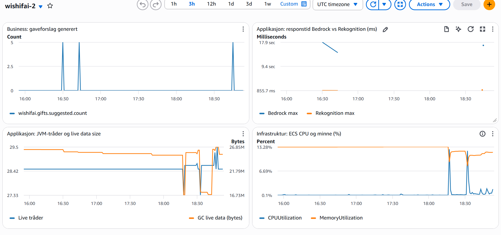

# README_SVAR PGR301 Eksamen 2026

Kandidatnummer: 2

## Oppgave 1 - Container og CI (20p)

### 1A — Containerisér Spring Boot-applikasjonen

Jeg har laget en multi-stage `Dockerfile`. Første steg bygger JAR-filen med Maven, og andre steg kopierer bare JAR-filen inn i et image. Ting som Maven, JDK og kildekoden blir med i det ferdige imaget, så det blir mindre og har færre ting som kan utnyttes (programmet blir mer lettvektig).

Bygg og kjør fra repo-rot:

```
docker build -t wishifai .
docker run -p 9999:8080 wishifai
```

Containeren lytter da på localhost:9999. Sjekk at den svarer med en curl (client url): 

```
curl http://localhost:9999/actuator/health
```

### 1B - CI-pipeline

Workflow-filen ligger i `.github/workflows/docker.yml` og kjører bare ved push til main (merk at jeg endret navnet på denne filen fra ecr.yml til docker.yml i ettertid).

Grønn kjøring: https://github.com/richrase/eksamen-devops2026/actions/runs/41548349004

Først kjører `mvn test`, og deretter bygger imaget og pusher det til ECR-repoet wishifai-2. Byggejobben er avhengig av at testene går gjennom (merk at det ikke er noen tester i oppgaven, så denne delen bare kjører grønt uansett så lenge koden compiler), så imaget blir ikke publisert hvis testene feiler.

De dyrebare AWS-nøklene ligger som GitHub Secrets og står ikke i workflow-filen. ECR-repoet opprettet jeg manuelt i CLI.

Tagging-strategien: hvert image får to tagger, kort commit-SHA (f.eks 0fc6572) og lateest.

Jeg valgte commit-SHA fordi den er unik for hver commit. Da kan jeg se nøyaktig hvilken kode som kjører, og jeg kan rulle tilbake ved å peke på en eldre SHA. Den kommer rett fra Git, så det er ikke noe versjonsnummer jeg kan glemme. Terraform får også SHA-en inn som image-tag, så hver commit gir en ny verdi og dermed en ny kjøring. Latest er bare med for at det skal være enkelt å teste lokalt. Alene holder den ikke, fordi den flyttes ved hver push, og da vet man ikke hvilken versjon som faktisk kjører. Så matcher taggingen med commit sha-en. 

## Oppgave 2 - ECS Express med Terraform (25p)

### 2A - Infrastruktur for tjenesten

All Terraformkoden ligger i `infra/`. Den oppretter en ECS Express-tjeneste, en S3-bucket for bildene og en taskrole.

Offentlig URL: https://wi-30706d5f6c3441398601ceb06075021f.ecs.eu-west-1.on.aws

```
curl https://wi-30706d5f6c3441398601ceb06075021f.ecs.eu-west-1.on.aws/actuator/health
curl -F "image=@samples/sample_image.png" https://wi-30706d5f6c3441398601ceb06075021f.ecs.eu-west-1.on.aws/api/analyze
```

Litt om valgene jeg har gjort:

- Region, kandidatnummer og image-tag er variabler. Region har eu-west-1 som standard. De to andre har ingen standardverdi, så de må oppgis hver gang.
- Alle ressurser har kandidatnummeret i navnet, så de ikke kolliderer med andre i klassens konto.
- Bucketen heter wishifai-uploads-2 og er privat. S3_BUCKET settes automatisk fra bucketen Terraform lager, så navnet står bare ett sted.
- Task role heter wishifai-task-role-2 og er opprettet i Terraform. Den har bare det appen trenger, skriver til egen bucket, DetectLabels i Rekognition, InvokeModel i Bedrock og PutMetricData til CloudWatch.
- Tjenesten kjører på port 8080 med health check mot `/actuator/health`.

### 2B - Remote state

State lagres i bucketen pgr301-terraform-state med nøkkelen `wishifai/2/terraform.tfstate`. Kandidatnummeret er en del av stien, så den er unik. Dette er satt opp i `infra/backend.tf`.

Med remote state bruker både Codespacet mitt og GitHub Actions samme state. Runneren i GitHub Actions er ny hver gang, så med lokal state ville pipelinen prøvd å opprette alt på nytt ved hver kjøring. staten er ikke låst.

### 2C - GitHub Actions-job for Terraform

Workflow filen til github actions fra 1B har fått en ny task som kjører Terraform. Den har `needs` på jobben som bygger og pusher imaget, så rekkefølgen er test, så bygg å push, så Terraform.

Grønne kjøringer:

- https://github.com/richrase/eksamen-devops2026/actions/runs/41885518256
- https://github.com/richrase/eksamen-devops2026/actions/runs/42398462695 - > (med dashboard og alarm)

Jobben kjører først `terraform fmt -check`, så pipelinen feiler hvis koden ikke er riktig formatert. Deretter kjører den `terraform init` og `terraform apply` med kandidatnummer og kort commit-SHA som variabler.

Hvorfor Terraform kjører etter container-build:

Terraform bruker imaget med den ny commit SHA-en og det umaget må ligge i ECR før tjenesten kan starte det. Hvis terraform hadde kjørt før eller parralelt med build så kunne tjenesten pekt mot en tag som ikke var opprett enda. da ville deployment feilet. Sånn det er nå må testene kjøre og applikasjone bli bygd først. hvis det feiler blir staten urørt i AWS slik det var.

### 3A - Metrikker i applikasjonen

Jeg har lagt til tre metrikker med Micrometer:

- `rekognition.detect.time` en timer i `RekognitionService`: hvor lang tid Rekognition kallet tar
- `bedrock.converse.time` en timer i `BedrockService`: hvor lang tid Bedrock-kallet tar
- `wishifai.gifts.suggested` en counter i `WishlistService`: antall gaveforslag som er generert (business-metrikken)

`MetricsConfig` var allerede satt opp, så der endret jeg bare namespace til wishifai-2. Metrikkene sendes til CloudWatch hvert minutt.

Timerne bruker `record()` rundt selve kallet til AWS. Resten av koden (f.eks bygging av prompten og parsing av svaret) er ikke med, så tallet er bare ventetiden på Rekognition og Bedrock.

For å sjekke at det virket kjørte jeg appen lokalt, sendte inn et bilde og så på metrikkene med curl:

```
curl localhost:8080/actuator/metrics/bedrock.converse.time
curl localhost:8080/actuator/metrics/rekognition.detect.time
```

Etterpå sjekket jeg at de også lå i CloudWatch med `aws cloudwatch list-metrics --namespace wishifai-2`.

En analyse gjør tre ting laster opp bildet til S3, kaller Rekognition og kaller Bedrock. I CloudWatch ligger det litt over ti kall mot den deployede tjenesten, og et helt kall tar ca. 15-19 sekunder. Bedrock bruker 14-18 sekunder av dette (rundt 90 %), mens Rekognition bruker ca. 1 sekund. Det er altså Bedrockkallet som tar tiden.

Som businessmetrikk valgte jeg gaveforslag, fordi det er det brukerne faktisk får ut av tjenesten. Den kan også vise en feil som timerne ikke ser. Hvis svaret fra Bedrock ikke kan parses, returnerer `parseAnalysis` en tom liste. Brukeren får da 200 OK tilbake, men øker ikke.

### 3B - Dashboard og alarm

Koden ligger i `infra/dashboard.tf` og `infra/alarm.tf`. Dashboardet heter wishifai-2 og ligger i CloudWatch i eu-west-1.



Dashboardet har fire grafer:

- Business: antall gaveforslag. Viser hvor mye tjenesten blir brukt.
- Applikasjon, egne metrikker, tiden til Bedrock og Rekognition i samme graf. Her ser man direkte at det er Bedrock som tar mest tid. 
- Applikasjon, Actuator: antall tråder i JVM-en og minnebruk etter GC. Hver analyse holder på en tråd i 15-20 sekunder, så antall tråder stiger når mange bruker tjenesten samtidig.
- Infrastruktur: CPU og minne fra ECS. Viser om tregheten skyldes for lite ressurser. Det gjør den ikke, containeren bruker nesten ingen CPU og ca. 13 % minne.

Tjenesten tar tid på grunn av bedrock bruker tid på å svare tilbake. 

Alarmen heter wishifai-2-bedrock-slow. Den går når gjennomsnittlig tid for Bedrock-kallet er over 20 sekunder i 3 minutter på rad.

Jeg valgte Bedrock-tiden fordi den står for rundt 90 % av responstiden, så det er der brukerne først merker at noe blir tregere. Normale kall tar 14-18 sekunder. Jeg hadde først 15 sekunder, men det ligger midt i det normale og ville gitt alarm hele tiden. Kravet om 3 minutter på rad er der for at ett enkelt tregt kall ikke skal gi alarm. Minutter uten trafikk regnes som ok, siden ingen kall ikke er en feil.

## Oppgave 4 - Drøfteoppgave (15p)

Vanlig DevOps bygger på at samme input gir samme output. Da kan en test si rett eller galt, og en grønn pipeline betyr at koden gjør det den skal(forhåpentligvis). Med en språkmodell som claude i løsningen holder ikke det lenger. Wishifai kan svare med gyldig JSON og HTTP 200 OK, og likevel foreslå et knivsett til et barnerom. Teknisk er alt i orden, men svaret er feil. siden ett knivsett åpenbart ikke passer til ett barn.  

Når det gjelder testing av JSON output kan jeg ikke sjekke svaret mot en fasit, for det blir forskjellig hver gang man kjører programmet. Det jeg kan teste er egenskaper ved svaret, at det er gyldig JSON, at det har høyst fem forslag, og at ingen av dem er åpenbart farlige for barn. I tillegg trengs et evalueringssett, altså faste bilder der jeg vet omtrent hva et godt svar er, for eksempel bildet av barnerommet som er gitt. Svarene kan vurderes av en annen modell, med stikkprøver fra et menneske. Slike tester er trege, koster penger og ressuser, så de bør kjøre når prompten eller modellen endres, ikke på hver commit. Pipelinen min har ingen slike tester i dag, og det er den største mangelen i løsningen og oppgaven. 

For kontinuerlig leveranse er det at det som deployes er kode, prompt og modell. I Wishifai ligger prompten i Java koden, så en promptendring får sin egen commit-SHA og går gjennom samme pipeline som resten. Da er den lett å rulle tilbake (rollback). Modellen kan derimot byttes med en miljøvariabel uten at koden endres. Et modellbytte bør derfor behandles som en vanlig deploy, versjonert, kjørt mot evalueringssett og rullet ut til noen få brukere først. Det hjelper at modell ID-en peker på en datert versjon. Da endrer ikke oppførselen seg uten at jeg har gjort noe.

Overvåkingen min dekker bare hastighet. Alarmen varsler når Bedrock bruker over 20 sekunder, men den sier ingenting om innholdet, for et upassende forslag kommer like raskt som et godt forslag. Derfor trengs flere signaler, tokenforbruk og kostnad, hvor ofte svaret ikke lar seg forstås, hvor ofte modellen nekter å svare, og tilbakemeldinger fra brukerne. Telleren for antall gaveforslag er en liten start. Faller den til null forslag per analyse, har noe skjedd med svarene selv om alt annet ser grønt ut. og signaliserer da at noe må fikses. 

Hvor mye av dette som trengs, kommer an på hva som skjer når det går galt. For en gaveliste kan jeg leve med å oppdage de fleste feil i produksjon, så lenge farlige gaver til barn blir filtrert bort og brukerne kan melde om det. I en bank er det omvendt. Der må evalueringssett bestås før noe går i produksjon, endringer i prompt og modell må godkjennes og alle svar må logges så de kan testes. Rådgiveren tar fortsatt beslutningen selv.

Generativ AI endrer altså ikke prinsippene i DevOps. Små endringer, automatisering og rask tilbakemelding gjelder fortsatt. Men en grønn pipeline betyr mindre enn før, siden det er menneklige konsekvenser for hva AI gjør. som f.eks med hemmlig informasjon eller passord/nøkkler. Og jo større konsekvensene er, jo mer må mennesker følge med.
